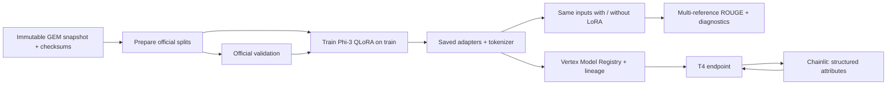

# Restaurant Studio — final project

Generate English restaurant descriptions from structured attributes with
Phi-3-mini-4k-instruct adapted on [GEM/e2e_nlg](https://huggingface.co/datasets/GEM/e2e_nlg).
The project reuses the same Git repository and Vertex/Chainlit architecture as the
course. The Yoda pipelines and historical results remain available.

See the **[current verified status](reports/restaurant_project.md)**,
[experimental protocol](docs/restaurant_protocol.md) and
[live presentation guide](docs/final_project_demo.md).
The [project notebook](notebooks/final_project.ipynb) walks through the same flow.
A compiled pipeline or successful smoke test alone does not establish model quality.



## Local setup

Use Python 3.11 and the existing `.env` Google Cloud credentials. New checkouts
should copy `.env.example` to `.env` and configure credentials. Restaurant resources
use dedicated variables, so the old Yoda endpoint/model cannot be selected silently.

```powershell
$env:UV_PROJECT_ENVIRONMENT = '.venv-session4'
uv sync --extra app --extra evaluation --group dev --link-mode copy
.\.venv-session4\Scripts\python.exe -m pytest -q
```

`WORKFLOW_TASK=restaurant` is the default. Set it to `yoda` to use the old serving
resources. Training runs in GPU containers; a local GPU is not required for data
preparation, pipeline compilation, scoring or the Chainlit client.

## Prepare the dataset

```powershell
.\.venv-session4\Scripts\python.exe scripts/prepare_restaurant_dataset.py
.\.venv-session4\Scripts\python.exe scripts/prepare_restaurant_dataset.py --offline --upload
.\.venv-session4\Scripts\python.exe scripts/audit_restaurant_quality.py
```

The script freezes public Parquet revisions and checksums. The official snapshot
has **33,525 train, 1,484 validation and 1,847 test rows**. No random train/test split
is introduced. References are retained and grouped by canonical input for evaluation.
Data, manifests and derived CSVs live under ignored `data/restaurant/`.
The GCS manifest URI is written to `data/restaurant/dataset_uri.txt`.

Dataset attribution and CC-BY-SA-4.0 terms are recorded in the protocol and manifest.
The code and data have separate provenance; the full dataset is not committed.

## Compile and run on Vertex

```powershell
# Local compilation only; no GPU allocation.
.\.venv-session4\Scripts\python.exe scripts/run_restaurant_pipeline.py --compile-only

# Technical check: 32 training rows, 2 updates and 8 validation inputs.
.\.venv-session4\Scripts\python.exe scripts/run_restaurant_pipeline.py --smoke-test

# Declared pilot: 4,000 training rows, 200 validation inputs, one epoch.
.\.venv-session4\Scripts\python.exe scripts/run_restaurant_pipeline.py --train-limit 4000 --validation-limit 200 --epochs 1

# Inspect an actual returned resource name.
.\.venv-session4\Scripts\python.exe scripts/inspect_pipeline.py projects/PROJECT/locations/REGION/pipelineJobs/RUN
```

These cloud runs allocate billable GPU jobs. Training and inference request one T4
per GPU task, 16 CPUs and 50 GB memory. Validation uses the official validation
split; the test data does not enter training or checkpoint selection.
Use limits of `0` for the complete split, and record the actual sample sizes.
The default generation is deterministic, with at most 128 new tokens.

For presentation figures, add `--extra plots` to the setup command. After
downloading a real run, `scripts/plot_restaurant_results.py` exports PNG/PDF
ROUGE comparisons and the logged training-loss curve to `reports/figures/`.
Regenerate these after changing the selected run.

After a successful pilot, download its artifacts:

```powershell
.\.venv-session4\Scripts\python.exe scripts/download_pipeline_artifacts.py projects/PROJECT/locations/REGION/pipelineJobs/RUN
.\.venv-session4\Scripts\python.exe scripts/write_restaurant_report.py
```

Download technical smoke tests to a separate directory and separate model/log paths;
do not overwrite the selected model or present smoke-test scores as final results.

After selecting the model on validation, evaluate its frozen adapters on the
**official test split without retraining**:

```powershell
.\.venv-session4\Scripts\python.exe scripts/run_restaurant_pipeline.py --evaluate-model gs://BUCKET/CHOSEN_RUN/model --test-limit 0
.\.venv-session4\Scripts\python.exe scripts/download_pipeline_artifacts.py projects/PROJECT/locations/REGION/pipelineJobs/TEST_RUN --output-dir data/restaurant/final_test
```

Scores compare base Phi-3 (adapters disabled) and fine-tuned Phi-3 under the same
prompt and generation settings. ROUGE-1/2/L F1 uses the best available reference
for each metric, then averages per unique input. Literal name/landmark coverage
is a limited diagnostic. Check unsupported details and negation manually as well.

## Register, deploy and demonstrate

These commands require successful **Restaurant** training artifacts downloaded to
the default directory. Registration preserves source-pipeline lineage.

```powershell
.\.venv-session4\Scripts\python.exe scripts/register_model_with_custom_handler.py --dry-run
.\.venv-session4\Scripts\python.exe scripts/register_model_with_custom_handler.py
.\.venv-session4\Scripts\python.exe scripts/manage_endpoint.py deploy
.\.venv-session4\Scripts\python.exe scripts/test_online_endpoint.py
.\.venv-session4\Scripts\python.exe scripts/run_chat.py
```

Open `http://localhost:8000` and paste attributes from `examples/restaurants.json`.
The app applies the same instruction and canonical ordering as training and uses
Application Default Credentials to call Vertex. `AUTH_MODE=gcloud` is also supported.
No token is stored in result files. Deployment writes the dedicated Restaurant
model/endpoint IDs to the ignored `.env`; restart Chainlit after these change.

In another terminal:

```powershell
uvx --from playwright python scripts/verify_chainlit_browser.py
.\.venv-session4\Scripts\python.exe scripts/demo_restaurant.py
```

On Windows the browser check uses installed Microsoft Edge. Elsewhere install
Chromium with `uvx --from playwright python -m playwright install chromium`.
With no deployed endpoint, `--expect-offline` verifies only the UI error flow.
The explicit replay mode in the presentation guide uses recorded pipeline outputs.

**After testing, stop Chainlit and remove the billable endpoint:**

```powershell
.\.venv-session4\Scripts\python.exe scripts/manage_endpoint.py cleanup
.\.venv-session4\Scripts\python.exe scripts/manage_endpoint.py list
```

The script checks ownership labels and keeps registered models and source weights.
Start deployment before the presentation: provisioning can take 15–30 minutes and
requires T4 serving quota separate from training quota.

## Course history

- [Previous course workflow](docs/course_workflow.md)
- [Session 3: Yoda training and evaluation](reports/session3_results.md)
- [Session 4: Yoda deployment and app](reports/session4_results.md)

The existing `scripts/pipeline_runner.py` and Yoda pipeline functions are retained
for those sessions. New final-project runs use `scripts/run_restaurant_pipeline.py`.
