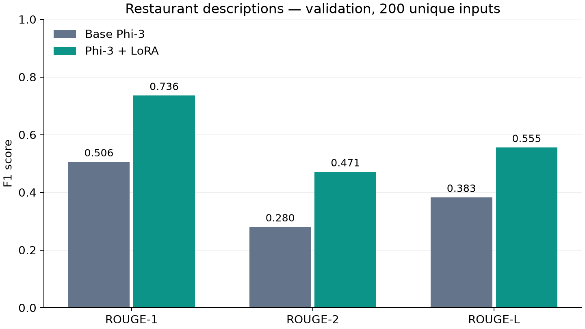
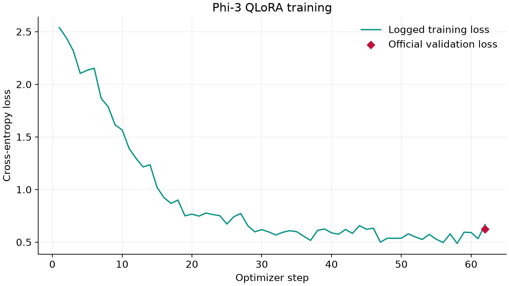

# Projet final — Restaurant Studio

État documenté le 13/11/2026. Les résultats ci-dessous proviennent des artefacts locaux des runs Vertex, du test navigateur et de la vérification Chainlit.

## Données vérifiées

Dataset : [GEM/e2e_nlg](https://huggingface.co/datasets/GEM/e2e_nlg), anglais, licence CC-BY-SA-4.0.
Révision source : `0e089c2ba61c3a0d183815c87c2c95e98fb446a6`. Révision Parquet : `f97230c6d02c1678ec0279be4dea6dc722803a0a`.

| Split officiel | Lignes source | MR uniques | Lignes préparées, corpus complet |
| --- | ---: | ---: | ---: |
| train | 33525 | 12568 | 33525 |
| validation | 1484 | 1484 | 1484 |
| test | 1847 | 1847 | 1847 |

MR avec valeurs contradictoires pour un même slot : `{"train": 1443, "validation": 190, "test": 141}`.
Références textuelles identiques entre splits, après normalisation casse/espaces : `{"train_validation": 1, "train_test": 0, "validation_test": 0}`.
Ces diagnostics sont distincts des chevauchements d'entrées ci-dessous. Le pilote conserve le corpus officiel ; aucun filtrage des contradictions n'a été expérimenté.

Chevauchements après normalisation : `{"train_validation": 0, "train_test": 0, "validation_test": 0}`.
Lignes train retirées pour chevauchement : 0.
Les répétitions de slots dans le corpus sont conservées et signalées ; elles ne sont pas silencieusement écrasées.

## Ce qui est adapté

Préparation reproductible, splits officiels, entraînement et évaluation base/LoRA, ROUGE multi-références, registre et endpoints séparés de Yoda, application Chainlit et exemples de démonstration. Le serving a ensuite adopté `restaurant-v2-security` avec validation des entrées et contrôle des sorties ; cette version a maintenant sa propre évaluation sur les entrées tenues à l'écart.

Le pipeline de test dédié évalue des adaptateurs figés sans réentraîner. Le code des sessions Yoda reste disponible.

## Exécutions et résultats

- Run soumis : `projects/123905721265/locations/europe-west2/pipelineJobs/lulik-restaurant-description-training-20261110175124` ; smoke test : `True` ; dernier état enregistré : `PIPELINE_STATE_SUCCEEDED`.
- Run soumis : `projects/123905721265/locations/europe-west2/pipelineJobs/lulik-restaurant-description-training-20261110181012` ; smoke test : `False` ; dernier état enregistré : `PIPELINE_STATE_SUCCEEDED`.

Run téléchargé : `projects/123905721265/locations/europe-west2/pipelineJobs/lulik-restaurant-description-training-20261110181012` ; état : `PIPELINE_STATE_SUCCEEDED`.
Taille train demandée : 1000.0 ; validation : 200.0 ; époques configurées : 1.0 ; learning rate : 0.0001.
Évaluation sur 200 MR ; split(s) : validation.

| ROUGE F1 | Base | Fine-tuned | Différence |
| --- | ---: | ---: | ---: |
| rouge1 | 0.5056 | 0.7358 | +0.2302 |
| rouge2 | 0.2801 | 0.4713 | +0.1912 |
| rougeL | 0.3826 | 0.5555 | +0.1728 |

Ces valeurs concernent uniquement les tailles et le split du run indiqué ; elles ne prouvent pas une amélioration sur le test complet.

Durée d'entraînement mesurée par le trainer : 473.0634 secondes, hors provisionnement et inférence. Loss de validation : 0.6234755516052246.
Paramètres entraînables : 12582912.0 sur 3833662464.0.

Essai technique téléchargé : `projects/123905721265/locations/europe-west2/pipelineJobs/lulik-restaurant-description-training-20261110175124` ; état : `PIPELINE_STATE_SUCCEEDED`. Les adaptateurs et scores de cet essai restent dans les dossiers smoke dédiés.

## Test tenu à l'écart

Évaluation officielle du split tenu à l'écart : `lulik-restaurant-heldout-evaluation-20261112173647`, terminée avec succès sur les 1 847 exemples de test (`test_limit=0`). Le modèle évalué est celui du run d'entraînement `lulik-restaurant-description-training-20261110181012` ; artefact d'adaptateurs : `gs://lulik-llmops/restaurant/pipelines/123905721265/lulik-restaurant-description-training-20261110181012/fine-tuning-component_378855560486846464/model`.

| ROUGE F1 (test officiel) | Base Phi-3 | Fine-tuned | Différence |
| --- | ---: | ---: | ---: |
| rouge1 | 0.5311 | 0.7386 | +0.2075 |
| rouge2 | 0.2901 | 0.4554 | +0.1653 |
| rougeL | 0.3858 | 0.5279 | +0.1421 |

Couverture littérale des entités : 0.9997 pour la base et 1.0000 pour le modèle adapté ; zéro sortie vide. Les fichiers détaillés se trouvent dans `data/restaurant/final_test/` (résumé, prédictions et évaluations). Ces métriques sont celles du prompt `restaurant-v1`, employé par ce run de fine-tuning et son test.

## Évaluation du serving `restaurant-v2-security`

Run Vertex sans réentraînement : `lulik-restaurant-heldout-evaluation-20261113030451`, avec le même modèle gelé que ci-dessus. Le prompt `restaurant-v2-security` a été vérifié dans `preparation.json`. Le pipeline a généré les prédictions base et adaptées pour les 1 847 entrées, puis l'analyse locale a appliqué les règles d'acceptation et le garde-fou de sortie de Chainlit. Le serving aurait rejeté 141 entrées avec attributs répétés avant toute génération ; ROUGE est donc calculé sur les 1 706 entrées acceptées. Le garde-fou a remplacé 30 réponses, soit 1,76 % des entrées acceptées.

| ROUGE F1 sur les 1 706 entrées acceptées | Base `v2-security` | Adapté, sortie brute | Adapté, sortie gardée | `v1` adapté, mêmes entrées |
| --- | ---: | ---: | ---: | ---: |
| rouge1 | 0.4582 | 0.7288 | 0.7292 | 0.7429 |
| rouge2 | 0.2132 | 0.4550 | 0.4550 | 0.4620 |
| rougeL | 0.3222 | 0.5470 | 0.5479 | 0.5348 |

La couverture littérale des noms et lieux est de 0.9634 pour la sortie brute `v2-security`, contre 1.0000 pour `v1` sur le même sous-ensemble. Le contrôle de sortie modifie légèrement les scores ROUGE ; il ne remplace pas une revue des omissions ni une évaluation par juge LLM. Les scores Langfuse existants couvrent les conversations de test, pas les 1 706 prédictions de ce run. Artefacts : `data/restaurant/security_v2_eval/security_v2_summary.json`, `security_v2_evaluation.csv` et `security_v2_rejections.csv`.

## Application et statut de la démonstration

Vérification navigateur du 12/11 : `live-prediction` sur `http://127.0.0.1:8001`, succès : `True`. La réponse attendue pour The Eagle a été observée. Modèle enregistré : `lulik-restaurant-phi3@1`, ressource `projects/123905721265/locations/europe-west2/models/8139695575542005760@1`. L'artefact local indique l'endpoint Restaurant `1037140731178778624` comme `deployed` (T4, `n1-standard-8`), mais l'état actuel n'a pas pu être revérifié auprès de Vertex depuis cet environnement.

Les tests Yoda ne valident pas ce modèle Restaurant. Le flux Chainlit applique maintenant des contrôles d'entrée et de sortie (`restaurant-v2-security`). Les entrées bloquées par le parseur n'appellent ni Vertex ni Langfuse ; les sorties générées sont contrôlées avant d'être renvoyées et enregistrées. Les vérifications sont ciblées et ne remplacent pas une revue de sécurité exhaustive.

Dans Langfuse, les traces restaurant sont suivies par des évaluateurs de fidélité, de naturel et de sécurité contre les injections. L'évaluateur de sécurité a produit des scores sur les observations testées. L'attachement des évaluateurs ne signifie pas que les entrées rejetées avant l'appel au modèle reçoivent un score.

## Limites et présentation

ROUGE mesure le recouvrement lexical, pas la vérité de tous les faits. La couverture littérale des noms et lieux ne mesure pas toute la fidélité sémantique. Examiner aussi les omissions, ajouts et négations. L'évaluation `v2-security` utilise le même split officiel, mais ne score que le sous-ensemble accepté par le parseur ; les 141 entrées à attributs répétés sont comptées comme rejets, pas comme générations réussies.
Les références contiennent encore du bruit, et le pilote utilise par défaut un sous-ensemble déclaré. La base Phi-3 peut déjà avoir rencontré ce benchmark lors de son préentraînement ; on ne peut pas l'exclure.

Voir le [protocole](../docs/restaurant_protocol.md) et le [déroulé de présentation](../docs/final_project_demo.md).
Les anciens résultats [Session 3](session3_results.md) et [Session 4](session4_results.md) concernent Yoda.
