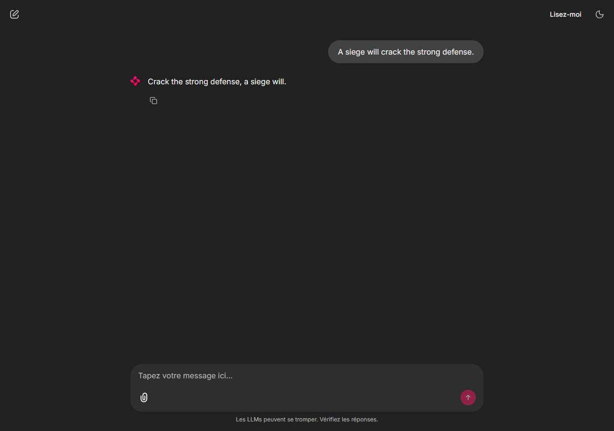

# Session 4 results — 27 October 2026

Session 4's registration, deployment and live application flow are complete.
Registered model version 2 served real predictions on one NVIDIA T4 in
`europe-west2`. Authenticated HTTP requests and the Chainlit browser test passed.
The model was then undeployed and the temporary endpoint deleted, as required by
the practice. Both registry versions and the source artifacts remain available.

| Practice step | Verified outcome |
| --- | --- |
| Standalone `EndpointHandler` | Loads the Phi-3 base model and saved LoRA adapters; exercised in the real serving container. Local tests use CPU test doubles. |
| Upload `handler.py` to GCS | Completed, with `serving/requirements.txt` beside the model artifacts. |
| Register a model | Completed: `lulik-yoda-phi3`, version 1. |
| Register another version with `parent_model` | Completed: version 2 under the same model resource. |
| Source-pipeline lineage | Native Vertex ML Metadata executions link both versions to the Session 3 model artifact. |
| T4 deployment | Succeeded: `n1-standard-8`, one T4, minimum/maximum replicas both 1. |
| Authenticated HTTP predictions | Single-instance fixture and two-instance batch returned valid Yoda translations from model version 2. |
| Chainlit app | Headless Edge submitted a sentence through the real app and verified the served response. |
| Resource cleanup | Model undeployed, endpoint deleted, `.env` endpoint ID cleared; endpoint listing confirmed no Session 4 endpoints. |

## Registered model and provenance

- Model: `projects/123905721265/locations/europe-west2/models/8215968697160826880`.
- Versions: `@1` (`session4-initial`) and `@2` (`session4-versioned`).
- Source run: `projects/123905721265/locations/europe-west2/pipelineJobs/lulik-yoda-model-training-20261022220009`.
- Source artifacts: `gs://lulik-llmops/pipelines/123905721265/lulik-yoda-model-training-20261022220009/fine-tuning-component_5965329005681836032/model`.
- Source metadata artifact: `projects/123905721265/locations/europe-west2/metadataStores/default/artifacts/16702871950548769014`.

The descriptions and local registration manifest preserve the pipeline and source
URI. Native metadata links connect the source artifact, registration execution
and registry model. The two versions demonstrate registry versioning using the
same fine-tuned weights.

Open [Model Registry](https://console.cloud.google.com/vertex-ai/models?authuser=1&project=agentics-workflows-510809),
select `europe-west2`, then `lulik-yoda-phi3`. The link preserves the working browser
account index `authuser=1`.

The serving container follows the course requirement:

```text
us-docker.pkg.dev/deeplearning-platform-release/gcr.io/huggingface-pytorch-inference-cu121.2-3.transformers.4-46.ubuntu2204.py311
```

Serving requirements select Transformers 4.46.3 and PEFT 0.13.2. Startup logs confirm
that the container found the custom handler, downloaded the base model shards,
loaded the checkpoint and reported `Model initialized successfully`. The handler
attaches the adapters, enables evaluation mode and cache, and uses CUDA/FP16 on
the T4. It decodes only newly generated tokens.

The image bundles Transformers 4.46.1, so pip emitted a dependency warning when
installing 4.46.3 against the toolkit's exact pin. Startup and all live prediction
checks succeeded with the installed version; changes to the image or dependencies
should be checked again against the real endpoint.

## Live predictions and browser evidence

Deployment operation started at **18:18:31 UTC** and completed at **18:38:22 UTC**
(approximately 20 minutes).

- Temporary endpoint: `projects/123905721265/locations/europe-west2/endpoints/5441977826095923200`.
- Deployed model ID: `639574918761021440`.
- HTTP response identified `modelVersionId: "2"`.
- Generation parameters: `max_new_tokens: 64`, `do_sample: false`.

| Input sentence | Actual served output |
| --- | --- |
| A siege will crack the strong defense. | Crack the strong defense, a siege will. |
| The force will guide your path. | Guide your path, the force will. |

The sample JSON request returned `predictions[].generated_text`. A separate
two-instance request applied the saved tokenizer's chat template to both sentences
and returned two nonempty responses, without prompt text or special role tokens.
That batch request took approximately 2.3 seconds; this is a single observed run,
not a performance benchmark.

The Playwright check used headless Microsoft Edge against the real local Chainlit
server. It loaded the app, submitted the first sentence above, and verified the
expected model response. This exercises browser → Chainlit → authenticated HTTP →
Vertex → custom handler → model → browser.



Raw evidence is saved locally under the ignored `data/session4/` directory:

- `online_prediction.json`: the single-instance Vertex response.
- `batch_prediction.json`: the two-instance response and elapsed time.
- `browser_verification.json` and `chainlit_chat.png`: successful live browser check.
- `deployed_endpoint.json`: endpoint configuration before cleanup.
- `endpoint.json`: final cleanup state, `deleted`.

## Local verification and environment

All **21 Python tests pass**, covering the Session 3 pipeline and Session 4 handler,
HTTP client and registration provenance. Local handler tests use CPU test doubles;
real model loading and generation were verified remotely on the T4. The optional
local notebook model-loading experiment still requires training dependencies and
a CUDA-capable machine.

Application Default Credentials authenticated the actual HTTP requests, with
automatic token refresh. The optional `AUTH_MODE=gcloud` path implements the
practice's subprocess access-token method; `gcloud` is unavailable in this
environment. Tokens remain in memory and are not written to result files or `.env`.

Session 4 uses `.venv-session4` because Windows blocked updates to the earlier
environment. `scripts/run_chat.py` supplies a valid child-process `DEBUG` value so
the IDE's `DEBUG=release` setting does not prevent Chainlit from starting.

## Quota history and cleanup

The first deployment failed with `429 ResourceExhausted` on
`CustomModelServingT4GPUsPerProjectPerRegion`. Its endpoint
`4483837005372850176` was deleted. After the user reported available serving
capacity, the new deployment succeeded. No quota increase was submitted by these
scripts. The [earlier quota request](session4_quota_request.md) remains as history.

After live testing, cleanup undeployed model `639574918761021440`, deleted endpoint
`5441977826095923200`, and cleared `GCP_ENDPOINT_ID` in the ignored `.env`. A follow-up
cloud listing returned `Endpoints: []` for Session 4 and still listed the registry
model. The local Chainlit server was stopped.

During cleanup, the SDK rejected an explicit empty traffic map. The cleanup script
now lets the SDK remove the last model's traffic automatically; the corrected
script completed the real undeployment and deletion successfully.

To chat again, redeploy existing version 2 and start the app using the commands in
the [README](../README.md#session-4-register-deploy-and-chat). Deployment allocates
billable serving resources again; run cleanup after use.

References: [Hugging Face serving containers](https://github.com/huggingface/Google-Cloud-Containers),
[custom handler contract](https://huggingface.co/docs/inference-endpoints/guides/custom_handler),
[Chainlit Python app](https://docs.chainlit.io/get-started/pure-python).
